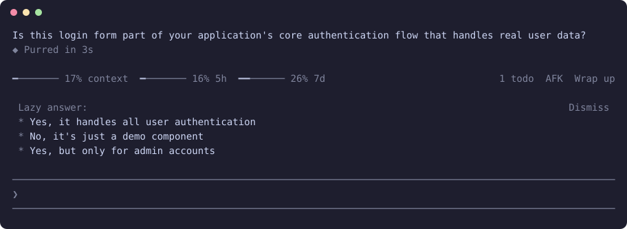

<h1 align="center">claude-lazy-reply</h1>

<p align="center"><b>Answer Claude with one tap: a fast model offers the replies you were about to type.</b></p>

<p align="center">
  
  
  
</p>

<p align="center"></p>

<p align="center"><sub>A real question from Claude and the replies offered under it. This mod draws only the Lazy answer list.</sub></p>

Most replies are a few words. After each turn, a fast model reads what Claude said and offers two or three answers as buttons. A press only fills the prompt box, so a wrong tap can never approve anything.

## Install

In a terminal, inside Claude Code:

```
/plugin install lazy-reply --marketplace YlitaloJuha/claude-lazy-reply
```

Or from a shell:

```bash
claude plugin install lazy-reply --marketplace YlitaloJuha/claude-lazy-reply
```

In the desktop app, click + next to the prompt box, then Plugins, Add marketplace with `YlitaloJuha/claude-lazy-reply`, then Add plugin.

> [!NOTE]
> This repository is private for now. Installing needs read access and a GitHub credential on your machine, such as `gh auth login` then `gh auth setup-git`.

## What it does

- **Based on what Claude just said:** Answers to its question, or the next step it named. Nothing when it is not waiting on you.
- **Never sends:** A press puts the reply in the prompt box, after anything you already typed. You still press Enter.
- **Stays quiet:** Hidden while Claude works, and cleared by your next message. No calls for subagents, failed turns or AFK runs.
- **In your language:** Replies follow the language of your last message.

## Commands

| Command | What it does |
|---|---|
| `/lazy on` | Turn suggestions on |
| `/lazy off` | Turn suggestions off, across sessions |
| `/lazy` | Show whether they are on |

## What it costs

One Haiku call after each finished turn.

## What it can reach

No network, no shell commands and no file access through the mod API. The end of the last reply and your last message go to Haiku through Claude Code, the same provider as your session. Run `claude plugin validate .` in this repository to list every call it makes.

## Limits

- Some suggestions will miss. They are a guess from the last reply alone.
- Claude Code's own suggested reply can show in the prompt box at the same time.
- A press has only been tested in the test kit, not live.

## Develop

```bash
claude plugin validate .
claude plugin test .
claude --plugin-dir .
```

## Credits

- The "untrusted reply" prompt pattern follows [reflect-mod](https://github.com/BayramAnnakov/claude-reflect) (MIT).

## License

Not chosen yet, so all rights are reserved for now.
